
<a href="./README.md">English</a> · <b>한국어</b>

<a href="https://junixion.com"><picture><source media="(max-width: 600px) and (prefers-color-scheme: dark)" srcset="./assets/header-m-ko-dark.svg" /><source media="(max-width: 600px)" srcset="./assets/header-m-ko-light.svg" /><source media="(prefers-color-scheme: dark)" srcset="./assets/header-ko-dark.svg" /></picture></a>

<picture><source media="(prefers-color-scheme: dark)" srcset="./assets/social-company-label-dark.svg" /></picture><a href="https://www.instagram.com/junixion.official/"><picture><source media="(prefers-color-scheme: dark)" srcset="./assets/social-company-instagram-dark.svg" /></picture></a><a href="https://www.threads.com/@junixion.official"><picture><source media="(prefers-color-scheme: dark)" srcset="./assets/social-company-threads-dark.svg" /></picture></a><a href="https://x.com/junixion"><picture><source media="(prefers-color-scheme: dark)" srcset="./assets/social-company-x-dark.svg" /></picture></a><a href="https://www.facebook.com/junixion.official"><picture><source media="(prefers-color-scheme: dark)" srcset="./assets/social-company-facebook-dark.svg" /></picture></a> 
<picture><source media="(prefers-color-scheme: dark)" srcset="./assets/social-nalbom-label-dark.svg" /></picture><a href="https://www.instagram.com/nalbom.app/"><picture><source media="(prefers-color-scheme: dark)" srcset="./assets/social-nalbom-instagram-dark.svg" /></picture></a><a href="https://www.threads.com/@nalbom.app"><picture><source media="(prefers-color-scheme: dark)" srcset="./assets/social-nalbom-threads-dark.svg" /></picture></a><a href="https://x.com/nalbomapp"><picture><source media="(prefers-color-scheme: dark)" srcset="./assets/social-nalbom-x-dark.svg" /></picture></a><a href="https://www.facebook.com/nalbomapp"><picture><source media="(prefers-color-scheme: dark)" srcset="./assets/social-nalbom-facebook-dark.svg" /></picture></a><a href="https://www.tiktok.com/@nalbom.app"><picture><source media="(prefers-color-scheme: dark)" srcset="./assets/social-nalbom-tiktok-dark.svg" /></picture></a> 
<picture><source media="(prefers-color-scheme: dark)" srcset="./assets/social-dev-label-dark.svg" /></picture><a href="https://www.linkedin.com/in/jun-yeong-song/"><picture><source media="(prefers-color-scheme: dark)" srcset="./assets/social-dev-linkedin-dark.svg" /></picture></a><a href="https://gitlab.com/jjuunnii98"><picture><source media="(prefers-color-scheme: dark)" srcset="./assets/social-dev-gitlab-dark.svg" /></picture></a><a href="https://huggingface.co/JUNIXION"><picture><source media="(prefers-color-scheme: dark)" srcset="./assets/social-dev-huggingface-dark.svg" /></picture></a>

<a href="https://junixion.com">junixion.com</a> · <a href="mailto:contact@junixion.com">contact@junixion.com</a> · <a href="https://papers.ssrn.com/abstract=6656258">SSRN 논문</a>

 

<picture><source media="(max-width: 600px) and (prefers-color-scheme: dark)" srcset="./assets/section-now-m-ko-dark.svg" /><source media="(max-width: 600px)" srcset="./assets/section-now-m-ko-light.svg" /><source media="(prefers-color-scheme: dark)" srcset="./assets/section-now-ko-dark.svg" /></picture>

<a href="https://junixion.com"><picture><source media="(max-width: 600px) and (prefers-color-scheme: dark)" srcset="./assets/now-m-ko-dark.svg" /><source media="(max-width: 600px)" srcset="./assets/now-m-ko-light.svg" /><source media="(prefers-color-scheme: dark)" srcset="./assets/now-ko-dark.svg" /></picture></a>

<picture><source media="(max-width: 600px) and (prefers-color-scheme: dark)" srcset="./assets/roadmap-m-ko-dark.svg" /><source media="(max-width: 600px)" srcset="./assets/roadmap-m-ko-light.svg" /><source media="(prefers-color-scheme: dark)" srcset="./assets/roadmap-ko-dark.svg" /></picture>

<picture><source media="(max-width: 600px) and (prefers-color-scheme: dark)" srcset="./assets/kpi-m-ko-dark.svg" /><source media="(max-width: 600px)" srcset="./assets/kpi-m-ko-light.svg" /><source media="(prefers-color-scheme: dark)" srcset="./assets/kpi-ko-dark.svg" />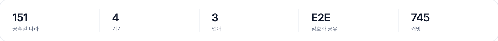</picture>

 

<picture><source media="(max-width: 600px) and (prefers-color-scheme: dark)" srcset="./assets/section-nalbom-m-ko-dark.svg" /><source media="(max-width: 600px)" srcset="./assets/section-nalbom-m-ko-light.svg" /><source media="(prefers-color-scheme: dark)" srcset="./assets/section-nalbom-ko-dark.svg" /></picture>

<picture><source media="(max-width: 600px) and (prefers-color-scheme: dark)" srcset="./assets/lead-nalbom-m-ko-dark.svg" /><source media="(max-width: 600px)" srcset="./assets/lead-nalbom-m-ko-light.svg" /><source media="(prefers-color-scheme: dark)" srcset="./assets/lead-nalbom-ko-dark.svg" />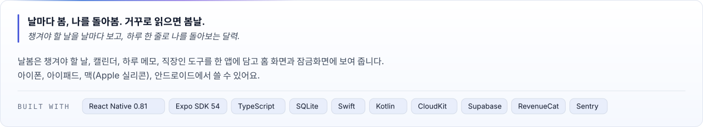</picture>

<picture><source media="(max-width: 600px) and (prefers-color-scheme: dark)" srcset="./assets/features-m-ko-dark.svg" /><source media="(max-width: 600px)" srcset="./assets/features-m-ko-light.svg" /><source media="(prefers-color-scheme: dark)" srcset="./assets/features-ko-dark.svg" />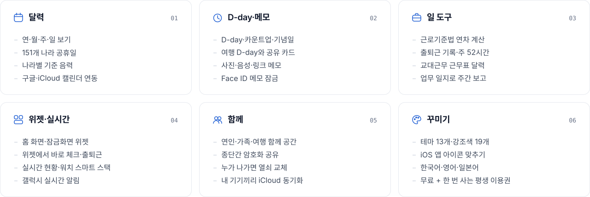</picture>

<kbd>어떻게 만들었나</kbd>

 

| 영역 | 한 일 |
|---|---|
| **기본은 기기 안** | 모든 기록은 휴대폰 안 SQLite에 저장해요(데이터 구조 변경 54번). 기본 기능은 계정 없이 다 돼요. 광고·분석 도구·AI 호출이 없어요. |
| **서버는 꼭 필요한 곳만** | 서울 리전의 작은 Supabase 프로젝트를 공휴일 표 업데이트, 함께 공간, D-day 웹 링크에만 써요. 행 단위 보안(RLS), 익명 로그인, Edge Function 4개, 남용 제한, 7일 뒤 지우기. |
| **암호화** | 함께 보는 기록과 사진은 올리기 전에 기기에서 OS 기본 AES-GCM으로 암호화해요. 서버에는 암호문만 남아요. 공간 열쇠는 세대별 열쇠 묶음으로 교체해요. |
| **iCloud 동기화** | 사용자 본인 CloudKit 개인 DB에서 `CKSyncEngine`으로 맞추는 Swift 모듈. 사진·음성 메모는 Wi-Fi에서만 맞춰요. |
| **네이티브 코드** | Swift·Kotlin으로 만든 모듈과 확장 10개: 위젯, 공유 확장, 실시간 현황, 안드로이드 실시간 알림, CloudKit 동기화, OS 암호화, 장소 찾기, 근무표 사진 읽기. |
| **품질** | 빌드마다 테스트 스크립트 70개와 타입 검사를 돌려요. 시뮬레이터에서 출시용(Release) 빌드로 한 번 더 확인하고, 올리기 전에 아카이브를 열어 점검해요. 충돌 보고(Sentry)는 사용자가 켤 때만, 개인 정보 칸은 지워서 받아요. |
| **출시** | iOS와 안드로이드를 같은 빌드 번호로 함께 내요. TestFlight·Google Play 출시 노트는 한국어·영어·일본어로 써요. |

 

<picture><source media="(max-width: 600px) and (prefers-color-scheme: dark)" srcset="./assets/section-web-m-ko-dark.svg" /><source media="(max-width: 600px)" srcset="./assets/section-web-m-ko-light.svg" /><source media="(prefers-color-scheme: dark)" srcset="./assets/section-web-ko-dark.svg" /></picture>

<picture><source media="(max-width: 600px) and (prefers-color-scheme: dark)" srcset="./assets/lead-web-m-ko-dark.svg" /><source media="(max-width: 600px)" srcset="./assets/lead-web-m-ko-light.svg" /><source media="(prefers-color-scheme: dark)" srcset="./assets/lead-web-ko-dark.svg" />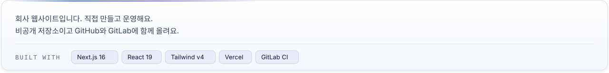</picture>

<picture><source media="(max-width: 600px) and (prefers-color-scheme: dark)" srcset="./assets/web-m-ko-dark.svg" /><source media="(max-width: 600px)" srcset="./assets/web-m-ko-light.svg" /><source media="(prefers-color-scheme: dark)" srcset="./assets/web-ko-dark.svg" />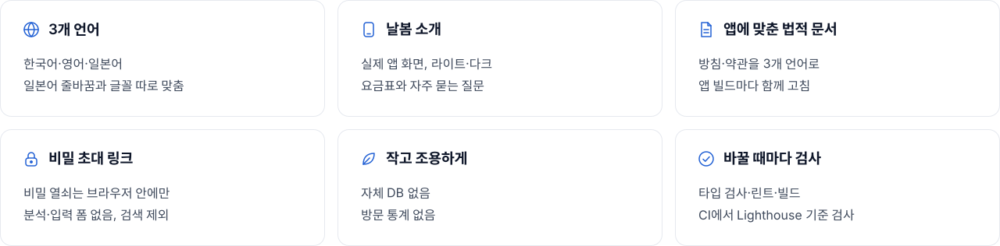</picture>

<kbd>웹사이트 자세히</kbd>

 

- **3개 언어**: 한국어·영어·일본어. 머리글에서 언어를 바꾸고, 일본어는 줄바꿈과 글꼴을 따로 맞췄어요.
- **날봄 소개**: 기능 소개, 실제 앱 화면(라이트·다크, 3개 언어), 요금표, 자주 묻는 질문.
- **앱에 맞춘 법적 문서**: 날봄 개인정보처리방침과 이용약관을 3개 언어로, 앱 빌드마다 함께 고쳐요. 사용자에게 불리한 내용은 파란 굵은 글씨로, 문장마다 줄을 바꿔요.
- **초대·D-day 링크**: `#` 뒤 비밀 열쇠는 브라우저 안에서만 써요. 분석 도구·입력 폼·리퍼러 없음, 검색 제외.
- **작고 조용하게**: 자체 DB 없음, 방문 통계 없음(속도 측정만), 라이트·다크 모드.
- **바꿀 때마다 검사**: GitLab CI가 타입 검사, 린트, 빌드, Lighthouse 기준 검사를 돌려요.
- **지금**: 검토 기간이에요. 법적 문서, 앱 링크, 프레스 이미지는 계속 공개돼요.

 

<picture><source media="(max-width: 600px) and (prefers-color-scheme: dark)" srcset="./assets/section-research-m-ko-dark.svg" /><source media="(max-width: 600px)" srcset="./assets/section-research-m-ko-light.svg" /><source media="(prefers-color-scheme: dark)" srcset="./assets/section-research-ko-dark.svg" /></picture>

<a href="https://papers.ssrn.com/abstract=6656258"><picture><source media="(max-width: 600px) and (prefers-color-scheme: dark)" srcset="./assets/research-m-ko-dark.svg" /><source media="(max-width: 600px)" srcset="./assets/research-m-ko-light.svg" /><source media="(prefers-color-scheme: dark)" srcset="./assets/research-ko-dark.svg" />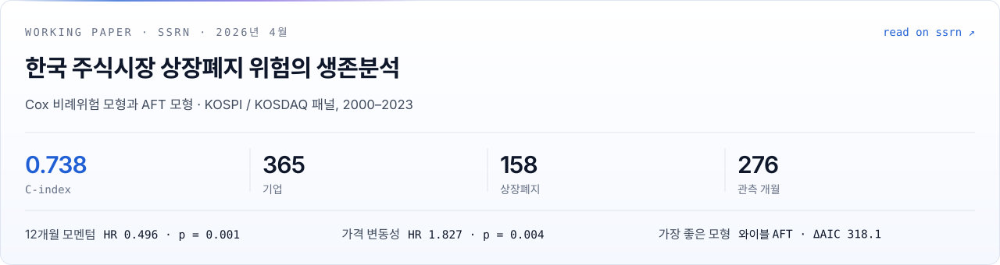</picture></a>

<kbd>전체 결과</kbd>

 

**한국 주식시장 상장폐지 위험의 생존분석**
Cox 비례위험 모형과 가속실패시간(AFT) 모형 — KOSPI/KOSDAQ 패널 데이터(2000–2023)

📄 [SSRN 워킹 페이퍼](https://papers.ssrn.com/abstract=6656258) · 2026년 4월 제출

> *정적 점수 모형(Altman Z-score, 로지스틱 회귀)은 실패를 예·아니오로만 보고 중도절단 관측을 버립니다. 이 논문은 대신 사건사 분석 방법을 씁니다.*

- KRX 생존 데이터셋 구축: 기업 365개, 상장폐지 158건, 276개월 관측(DART + FinanceDataReader)
- 카플란-마이어, Cox PH, 와이블·로그정규·로그로지스틱 AFT 모형 비교
- 시장 구분별 분산 차이를 담는 이분산 AFT 확장

| 결과 | 값 |
|---|---|
| 판별력 | **C-index = 0.738**, Shumway(2001) 미국 기준(C ≈ 0.74)과 비슷 |
| 가장 강한 예측 변수 | 12개월 모멘텀: HR = 0.496, p = 0.001 |
| 변동성 | 가격 변동성: HR = 1.827, p = 0.004 |
| 가장 좋은 모형 | 보조 척도를 둔 와이블 AFT: AIC = 1620.6, ΔAIC = 318.1 (p < 0.001) |
| 시장 차이 | KOSDAQ 대 KOSPI 로그순위 χ² = 10.57, p = 0.001 |

`생존분석` `Cox PH` `AFT` `KRX` `KOSPI` `KOSDAQ` `DART` `실증 연구`

**다음**: 시간에 따라 변하는 기저위험과 국면을 반영한 연속시간 위험 모형.

 

<picture><source media="(max-width: 600px) and (prefers-color-scheme: dark)" srcset="./assets/section-projects-m-ko-dark.svg" /><source media="(max-width: 600px)" srcset="./assets/section-projects-m-ko-light.svg" /><source media="(prefers-color-scheme: dark)" srcset="./assets/section-projects-ko-dark.svg" /></picture>

<a href="https://github.com/jjuunnii98/survival-analysis-finance"><picture><source media="(max-width: 600px) and (prefers-color-scheme: dark)" srcset="./assets/project-krx-m-ko-dark.svg" /><source media="(max-width: 600px)" srcset="./assets/project-krx-m-ko-light.svg" /><source media="(prefers-color-scheme: dark)" srcset="./assets/project-krx-ko-dark.svg" /></picture></a> <a href="https://huggingface.co/JUNIXION"><picture><source media="(max-width: 600px) and (prefers-color-scheme: dark)" srcset="./assets/project-lm-m-ko-dark.svg" /><source media="(max-width: 600px)" srcset="./assets/project-lm-m-ko-light.svg" /><source media="(prefers-color-scheme: dark)" srcset="./assets/project-lm-ko-dark.svg" /></picture></a>
 
<a href="https://crypto-risk-scoring-demo.onrender.com/docs"><picture><source media="(max-width: 600px) and (prefers-color-scheme: dark)" srcset="./assets/project-crypto-m-ko-dark.svg" /><source media="(max-width: 600px)" srcset="./assets/project-crypto-m-ko-light.svg" /><source media="(prefers-color-scheme: dark)" srcset="./assets/project-crypto-ko-dark.svg" /></picture></a> <a href="https://ml-churn-api-2z9m.onrender.com/docs"><picture><source media="(max-width: 600px) and (prefers-color-scheme: dark)" srcset="./assets/project-e2e-m-ko-dark.svg" /><source media="(max-width: 600px)" srcset="./assets/project-e2e-m-ko-light.svg" /><source media="(prefers-color-scheme: dark)" srcset="./assets/project-e2e-ko-dark.svg" /></picture></a>
 
<a href="https://survival-api.onrender.com/docs"><picture><source media="(max-width: 600px) and (prefers-color-scheme: dark)" srcset="./assets/project-grad-m-ko-dark.svg" /><source media="(max-width: 600px)" srcset="./assets/project-grad-m-ko-light.svg" /><source media="(prefers-color-scheme: dark)" srcset="./assets/project-grad-ko-dark.svg" /></picture></a> <a href="https://github.com/jjuunnii98/sql-analytics-portfolio"><picture><source media="(max-width: 600px) and (prefers-color-scheme: dark)" srcset="./assets/project-sql-m-ko-dark.svg" /><source media="(max-width: 600px)" srcset="./assets/project-sql-m-ko-light.svg" /><source media="(prefers-color-scheme: dark)" srcset="./assets/project-sql-ko-dark.svg" /></picture></a>

<kbd>자세히</kbd>

 

**[생존분석 — KRX](https://github.com/jjuunnii98/survival-analysis-finance)**
위 SSRN 논문의 코드. KRX 365개 기업, 2000–2023, 사건 비율 43.3%. 논문의 모든 표와 그림을 다시 만들어요.
Python · lifelines · pandas

**JunixionLM** *(비공개 · 개인 연구)*
사전학습 가중치 없이 PyTorch로 처음부터 짠 디코더 Transformer: RMSNorm, RoPE, GQA, KV 캐시, SwiGLU. 크기 세 가지(약 1,400만·1억 6,200만·4억 8,900만). 1억 6,200만 모델을 8억 1,700만 토큰(wikitext-103, 한국어·영어 위키백과)으로 50,000 스텝까지 학습, 평균 손실 1.6946(Kaggle T4 ×2).
PyTorch · Python · Hugging Face

**[암호화폐 하락 생존분석 데모](https://github.com/jjuunnii98/crypto-risk-scoring-demo)** [live api ↗](https://crypto-risk-scoring-demo.onrender.com/docs)
실시간 Binance 데이터로 24시간 안 3% 넘는 하락을 예측하는 Cox PH 모형, C-index 0.862. 특성 16개, 테스트 40개 통과.
Python · FastAPI · lifelines

**[엔드투엔드 ML 분석 시스템](https://github.com/jjuunnii98/end-to-end-ml-analytics-system)** [live api ↗](https://ml-churn-api-2z9m.onrender.com/docs)
통신사 고객 이탈 예측을 실제 서비스처럼. 랜덤 포레스트(ROC-AUC 0.83), 데이터 검증부터 Docker FastAPI까지.
Python · scikit-learn · Docker

**[대학원 ML 포트폴리오](https://github.com/jjuunnii98/grad-portfolio-ml)** [live api ↗](https://survival-api.onrender.com/docs)
METABRIC 유방암 생존분석(환자 1,353명). 벌점 Cox PH, 검증 C-index 0.638, FastAPI 서비스로 배포.
Python · lifelines · FastAPI

**[SQL 분석 포트폴리오](https://github.com/jjuunnii98/sql-analytics-portfolio)**
PostgreSQL 16으로 자산 9개 × 5년(13,489행)을 분석한 18개 쿼리. 윈도 함수부터 샤프 비율, 최대 낙폭, RSI, VWAP까지.
PostgreSQL · SQL

**[Python 분석 실습](https://github.com/jjuunnii98/python-analysis-lab)**
세 분야를 노트북 4개씩(EDA → 특성 → 모형 → 인사이트): 리테일 세분화·이탈, 시계열 지표·백테스트, XGBoost·SHAP 헬스케어 위험 분류.
Python · Jupyter

**[Python 스네이크 게임](https://github.com/jjuunnii98/python-snake-game)**
난이도 세 가지, 점수에 따라 빨라지는 속도, 최고 점수 저장, PyInstaller 실행 파일.
Python · Pygame

 

<picture><source media="(max-width: 600px) and (prefers-color-scheme: dark)" srcset="./assets/section-stack-m-ko-dark.svg" /><source media="(max-width: 600px)" srcset="./assets/section-stack-m-ko-light.svg" /><source media="(prefers-color-scheme: dark)" srcset="./assets/section-stack-ko-dark.svg" /></picture>

<picture><source media="(max-width: 600px) and (prefers-color-scheme: dark)" srcset="./assets/stack-m-ko-dark.svg" /><source media="(max-width: 600px)" srcset="./assets/stack-m-ko-light.svg" /><source media="(prefers-color-scheme: dark)" srcset="./assets/stack-ko-dark.svg" />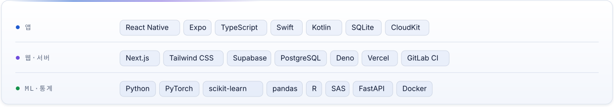</picture>

<picture><source media="(max-width: 600px) and (prefers-color-scheme: dark)" srcset="./assets/activity-m-ko-dark.svg" /><source media="(max-width: 600px)" srcset="./assets/activity-m-ko-light.svg" /><source media="(prefers-color-scheme: dark)" srcset="./assets/activity-ko-dark.svg" />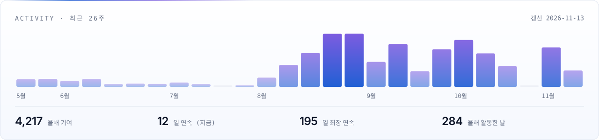</picture>

 

<picture><source media="(max-width: 600px) and (prefers-color-scheme: dark)" srcset="./assets/section-about-m-ko-dark.svg" /><source media="(max-width: 600px)" srcset="./assets/section-about-m-ko-light.svg" /><source media="(prefers-color-scheme: dark)" srcset="./assets/section-about-ko-dark.svg" /></picture>

<picture><source media="(max-width: 600px) and (prefers-color-scheme: dark)" srcset="./assets/about-m-ko-dark.svg" /><source media="(max-width: 600px)" srcset="./assets/about-m-ko-light.svg" /><source media="(prefers-color-scheme: dark)" srcset="./assets/about-ko-dark.svg" />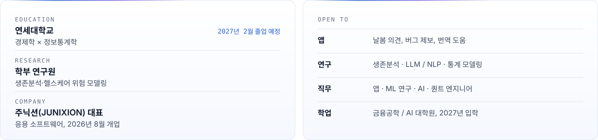</picture>

<kbd>자격증</kbd>

 

**취득**
- ADsP · SQLD · CDS 빅데이터 전문가 과정
- 2024 제주 스마트관광 빅데이터 해커톤 우수상 — 팀장

**준비 중**
- 투자자산운용사
- 빅데이터분석기사 · 정보처리기사

**계획**
- 리눅스마스터 1급 · 정보보안기사
- 금융투자분석사

 

<a href="mailto:contact@junixion.com"><picture><source media="(max-width: 600px) and (prefers-color-scheme: dark)" srcset="./assets/footer-m-ko-dark.svg" /><source media="(max-width: 600px)" srcset="./assets/footer-m-ko-light.svg" /><source media="(prefers-color-scheme: dark)" srcset="./assets/footer-ko-dark.svg" /></picture></a>
