
<b>English</b> · <a href="./README.ko.md">한국어</a>

<a href="https://junixion.com"><picture><source media="(prefers-color-scheme: dark)" srcset="./assets/header-dark.svg" /></picture></a>

<picture><source media="(prefers-color-scheme: dark)" srcset="./assets/social-company-label-dark.svg" /></picture><a href="https://www.instagram.com/junixion.official/"><picture><source media="(prefers-color-scheme: dark)" srcset="./assets/social-company-instagram-dark.svg" /></picture></a><a href="https://www.threads.com/@junixion.official"><picture><source media="(prefers-color-scheme: dark)" srcset="./assets/social-company-threads-dark.svg" /></picture></a><a href="https://x.com/junixion"><picture><source media="(prefers-color-scheme: dark)" srcset="./assets/social-company-x-dark.svg" /></picture></a><a href="https://www.facebook.com/junixion.official"><picture><source media="(prefers-color-scheme: dark)" srcset="./assets/social-company-facebook-dark.svg" /></picture></a> 
<picture><source media="(prefers-color-scheme: dark)" srcset="./assets/social-nalbom-label-dark.svg" /></picture><a href="https://www.instagram.com/nalbom.app/"><picture><source media="(prefers-color-scheme: dark)" srcset="./assets/social-nalbom-instagram-dark.svg" /></picture></a><a href="https://www.threads.com/@nalbom.app"><picture><source media="(prefers-color-scheme: dark)" srcset="./assets/social-nalbom-threads-dark.svg" /></picture></a><a href="https://x.com/nalbomapp"><picture><source media="(prefers-color-scheme: dark)" srcset="./assets/social-nalbom-x-dark.svg" /></picture></a><a href="https://www.facebook.com/nalbomapp"><picture><source media="(prefers-color-scheme: dark)" srcset="./assets/social-nalbom-facebook-dark.svg" /></picture></a><a href="https://www.tiktok.com/@nalbom.app"><picture><source media="(prefers-color-scheme: dark)" srcset="./assets/social-nalbom-tiktok-dark.svg" /></picture></a> 
<picture><source media="(prefers-color-scheme: dark)" srcset="./assets/social-dev-label-dark.svg" /></picture><a href="https://www.linkedin.com/in/jun-yeong-song/"><picture><source media="(prefers-color-scheme: dark)" srcset="./assets/social-dev-linkedin-dark.svg" /></picture></a><a href="https://gitlab.com/jjuunnii98"><picture><source media="(prefers-color-scheme: dark)" srcset="./assets/social-dev-gitlab-dark.svg" /></picture></a><a href="https://huggingface.co/JUNIXION"><picture><source media="(prefers-color-scheme: dark)" srcset="./assets/social-dev-huggingface-dark.svg" /></picture></a>

<a href="https://junixion.com">junixion.com</a> · <a href="mailto:contact@junixion.com">contact@junixion.com</a> · <a href="https://papers.ssrn.com/abstract=6656258">SSRN paper</a>

 

<picture><source media="(prefers-color-scheme: dark)" srcset="./assets/section-now-dark.svg" /></picture>

<a href="https://junixion.com"><picture><source media="(prefers-color-scheme: dark)" srcset="./assets/now-dark.svg" /></picture></a>

 

<picture><source media="(prefers-color-scheme: dark)" srcset="./assets/roadmap-dark.svg" /></picture>

 

<picture><source media="(prefers-color-scheme: dark)" srcset="./assets/kpi-dark.svg" />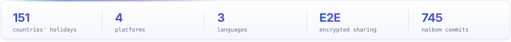</picture>

 

<picture><source media="(prefers-color-scheme: dark)" srcset="./assets/section-nalbom-dark.svg" /></picture>

<picture><source media="(prefers-color-scheme: dark)" srcset="./assets/lead-nalbom-dark.svg" />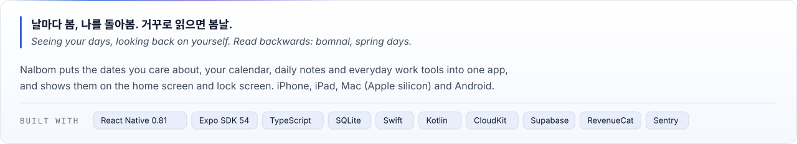</picture>

<picture><source media="(prefers-color-scheme: dark)" srcset="./assets/features-dark.svg" />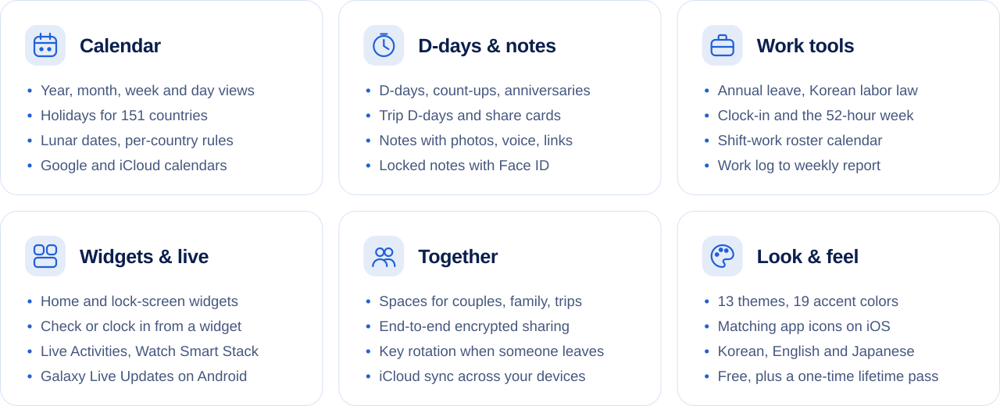</picture>

<b>How it is built</b>

 

| Area | What I did |
|---|---|
| **On-device first** | All records live in SQLite on the phone (54 schema migrations). No account is needed for any basic feature. No ads, no analytics, no AI calls. |
| **Server only where needed** | A small Supabase project (Seoul) for remote holiday tables, shared spaces and D-day web links: Row Level Security, anonymous sign-in, 4 Edge Functions, abuse limits, 7-day soft delete. |
| **Encryption** | Shared records and photos are encrypted on the device with the OS's own AES-GCM before upload, so the server only stores ciphertext. Space keys rotate through an epoch key ring. |
| **iCloud sync** | Native Swift module on `CKSyncEngine` in the user's private CloudKit database. Photos and voice notes sync on Wi-Fi only. |
| **Native code** | 10 native modules and extensions in Swift and Kotlin: widgets, share extension, Live Activities, Android live notifications, CloudKit sync, OS crypto, place search, roster photo reading. |
| **Quality** | 70 test scripts plus typecheck before every build. Each build is checked as a Release build on a simulator, then the archive is inspected before upload. Opt-in crash reports (Sentry) with personal fields scrubbed. |
| **Release** | iOS and Android ship in step: the same build number on TestFlight and Google Play, with release notes in Korean, English and Japanese. |

 

<picture><source media="(prefers-color-scheme: dark)" srcset="./assets/section-web-dark.svg" /></picture>

<picture><source media="(prefers-color-scheme: dark)" srcset="./assets/lead-web-dark.svg" />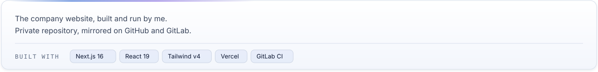</picture>

<picture><source media="(prefers-color-scheme: dark)" srcset="./assets/web-dark.svg" />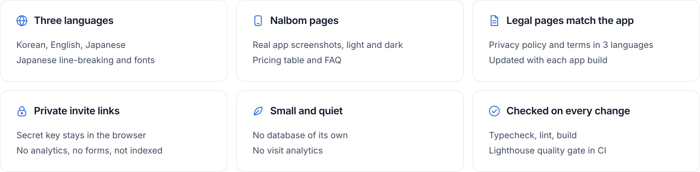</picture>

<b>Website details</b>

 

- **Three languages**: Korean, English and Japanese, with a language menu in the header and Japanese line-breaking and fonts.
- **Nalbom pages**: introduction, real app screenshots (light and dark, three languages), pricing table and FAQ.
- **Legal pages written to match the app**: Nalbom's privacy policy and terms in three languages, updated with each app build. Facts that are unfavorable to users are shown in bold blue, one sentence per line.
- **Invite and D-day links** for Nalbom: the secret key after `#` is only used inside the browser. No analytics, no forms, no referrer, not indexed.
- **Small and quiet**: no database of its own, no visit analytics (Speed Insights only), light and dark modes.
- **Checked on every change**: GitLab CI runs typecheck, lint, build and a Lighthouse gate.
- **Now**: in a review period. The legal pages, app links and press images stay public.

 

<picture><source media="(prefers-color-scheme: dark)" srcset="./assets/section-research-dark.svg" />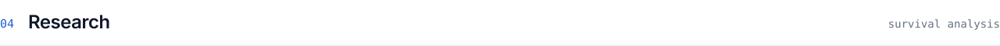</picture>

<a href="https://papers.ssrn.com/abstract=6656258"><picture><source media="(prefers-color-scheme: dark)" srcset="./assets/research-dark.svg" />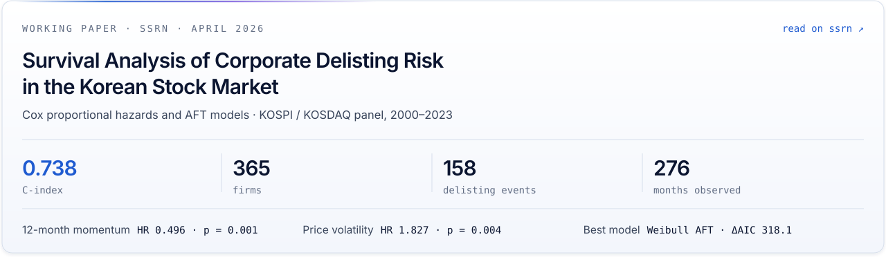</picture></a>

<b>Full results</b>

 

**Survival Analysis of Corporate Delisting Risk in the Korean Stock Market**  
Cox Proportional Hazards and Accelerated Failure Time Models — KOSPI/KOSDAQ Panel Data (2000–2023)

📄 [SSRN Working Paper](https://papers.ssrn.com/abstract=6656258) · Submitted April 2026

> *Static scoring models (Altman Z-score, logistic regression) treat failure as a yes-or-no outcome and drop censored observations. This paper uses event-history methods instead.*

- Builds a KRX survival dataset: 365 firms, 158 delisting events, a 276-month window (DART + FinanceDataReader)
- Compares Kaplan-Meier, Cox PH and Weibull / Log-Normal / Log-Logistic AFT models
- Adds a heteroscedastic AFT extension that captures the variance gap between market segments

| Finding | Result |
|---|---|
| Model discrimination | **C-index = 0.738**, close to the Shumway (2001) US benchmark (C ≈ 0.74) |
| Strongest predictor | 12-month momentum: HR = 0.496, p = 0.001 |
| Volatility | Price volatility: HR = 1.827, p = 0.004 |
| Best specification | Weibull AFT with ancillary scale: AIC = 1620.6, ΔAIC = 318.1 (p < 0.001) |
| Market difference | KOSDAQ vs. KOSPI log-rank χ² = 10.57, p = 0.001 |

`survival analysis` `Cox PH` `AFT` `KRX` `KOSPI` `KOSDAQ` `DART` `empirical research`

**Next**: continuous-time hazard models with time-varying baselines and regime conditioning.

 

<picture><source media="(prefers-color-scheme: dark)" srcset="./assets/section-projects-dark.svg" /></picture>

<a href="https://github.com/jjuunnii98/survival-analysis-finance"><picture><source media="(prefers-color-scheme: dark)" srcset="./assets/project-krx-dark.svg" /></picture></a> <a href="https://huggingface.co/JUNIXION"><picture><source media="(prefers-color-scheme: dark)" srcset="./assets/project-lm-dark.svg" /></picture></a>
 
<a href="https://crypto-risk-scoring-demo.onrender.com/docs"><picture><source media="(prefers-color-scheme: dark)" srcset="./assets/project-crypto-dark.svg" /></picture></a> <a href="https://ml-churn-api-2z9m.onrender.com/docs"><picture><source media="(prefers-color-scheme: dark)" srcset="./assets/project-e2e-dark.svg" /></picture></a>
 
<a href="https://survival-api.onrender.com/docs"><picture><source media="(prefers-color-scheme: dark)" srcset="./assets/project-grad-dark.svg" /></picture></a> <a href="https://github.com/jjuunnii98/sql-analytics-portfolio"><picture><source media="(prefers-color-scheme: dark)" srcset="./assets/project-sql-dark.svg" /></picture></a>

<b>Details</b>

 

**[Survival Analysis — KRX](https://github.com/jjuunnii98/survival-analysis-finance)**  
Code for the SSRN paper above. 365 KRX firms, 2000–2023, 43.3% event rate. Kaplan-Meier, Cox PH (C-index 0.738) and AFT models with a heteroscedastic extension. Reproduces every table and figure in the paper.  
Python · lifelines · pandas

**JunixionLM** *(private · personal research)*  
A decoder-only Transformer written from scratch in PyTorch, with no pre-trained weights: RMSNorm, RoPE, Grouped Query Attention, KV cache and a SwiGLU FFN. Three sizes (about 14M, 162M and 489M). The 162M model was trained on 817M tokens (wikitext-103 and Korean/English Wikipedia) to step 50,000, avg loss 1.6946, on Kaggle T4 ×2.  
PyTorch · Python · Hugging Face

**[Crypto Drawdown Survival Demo](https://github.com/jjuunnii98/crypto-risk-scoring-demo)** [live api ↗](https://crypto-risk-scoring-demo.onrender.com/docs)  
A Cox PH model for 24-hour drawdowns (> 3%) on live Binance data, C-index 0.862. 16 features (RSI, Bollinger, MACD, VWAP gap, ATR, Garman-Klass, Sortino, rolling MDD, funding-rate z-score). 40 passing tests.  
Python · FastAPI · lifelines

**[End-to-End ML Analytics System](https://github.com/jjuunnii98/end-to-end-ml-analytics-system)** [live api ↗](https://ml-churn-api-2z9m.onrender.com/docs)  
Telco churn prediction as a production ML system. Random Forest (ROC-AUC 0.83) with data validation, feature engineering, artifact-based inference and a Dockerized FastAPI.  
Python · scikit-learn · Docker

**[Graduate ML Portfolio](https://github.com/jjuunnii98/grad-portfolio-ml)** [live api ↗](https://survival-api.onrender.com/docs)  
Breast cancer survival analysis on METABRIC (1,353 patients). Penalized Cox PH, validation C-index 0.638, deployed as a FastAPI service.  
Python · lifelines · FastAPI

**[SQL Analytics Portfolio](https://github.com/jjuunnii98/sql-analytics-portfolio)**  
PostgreSQL 16 on 9 assets × 5 years (13,489 rows): 18 analyses in pure SQL, from window functions to Sharpe ratio, max drawdown, RSI and VWAP. yfinance → CSV → PostgreSQL → Makefile → Python tests.  
PostgreSQL · SQL

**[Python Analysis Lab](https://github.com/jjuunnii98/python-analysis-lab)**  
Three domains, each in four notebooks (EDA → features → model → insights): retail segmentation and churn, time-series indicators and backtests, and healthcare risk classification with XGBoost and SHAP.  
Python · Jupyter

**[Python Snake Game](https://github.com/jjuunnii98/python-snake-game)**  
Pygame snake with three difficulty modes, speed that grows with the score, saved high scores and a PyInstaller build.  
Python · Pygame

 

<picture><source media="(prefers-color-scheme: dark)" srcset="./assets/section-stack-dark.svg" /></picture>

<picture><source media="(prefers-color-scheme: dark)" srcset="./assets/stack-dark.svg" />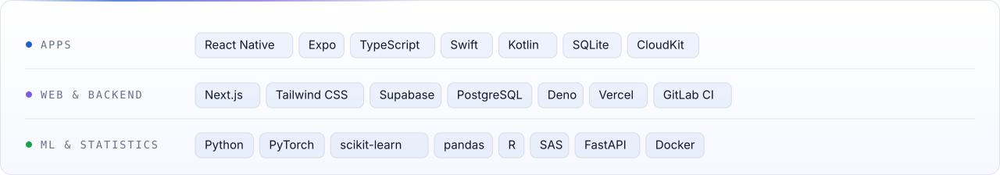</picture>

<picture><source media="(prefers-color-scheme: dark)" srcset="./assets/activity-dark.svg" />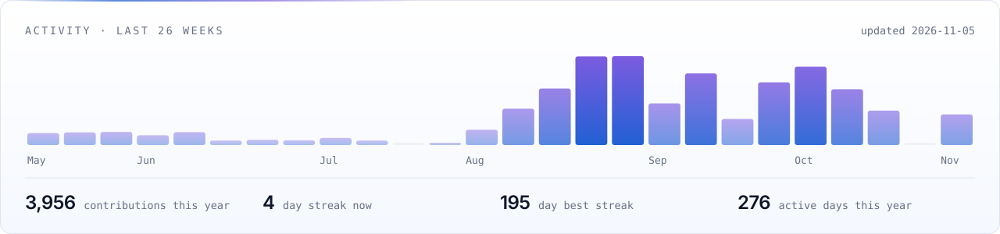</picture>

 

<picture><source media="(prefers-color-scheme: dark)" srcset="./assets/section-about-dark.svg" />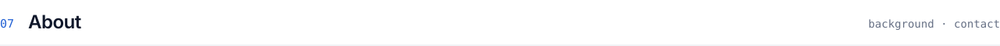</picture>

<picture><source media="(prefers-color-scheme: dark)" srcset="./assets/about-dark.svg" />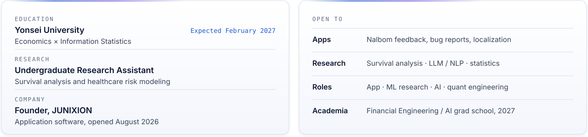</picture>

<b>Certifications</b>

 

**Completed**
- ADsP · SQLD · CDS 빅데이터 전문가 과정
- 2024 제주 스마트관광 빅데이터 해커톤 우수상 — Team Leader

**In progress**
- 투자자산운용사 (Investment Asset Manager)
- 빅데이터분석기사 (Big Data Analytics Engineer) · 정보처리기사 (Engineer Information Processing)

**Planned**
- 리눅스마스터 1급 (Linux Master Level 1) · 정보보안기사 (Engineer Information Security)
- 금융투자분석사 (Financial Investment Analyst)

 

<a href="mailto:contact@junixion.com"><picture><source media="(prefers-color-scheme: dark)" srcset="./assets/footer-dark.svg" /></picture></a>
